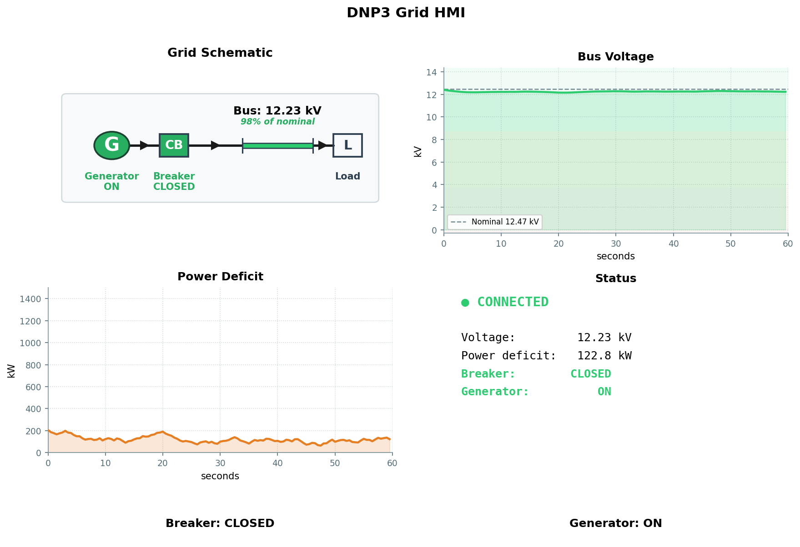
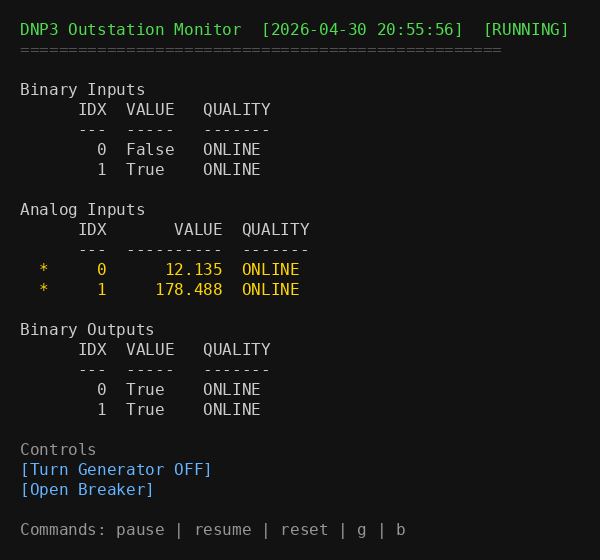

# Grid Watch

A simulated electrical grid outstation with DNP3 process control, built as a target for [MITRE Caldera™ for OT](https://github.com/mitre/caldera-ot). For a walkthrough, read [Caldera for OT — Grid Watch: A Virtual DNP3 Electrical Grid Sandbox](https://medium.com/@mitrecaldera/caldera-for-ot-grid-watch-a-virtual-dnp3-electrical-grid-sandbox-761e8c83ab77).



## Authors

Created by University of Hawaii at Manoa students: Yueming Guo, Lewen Lin, Myra Angelica Ortigosa, and Justin Smith.

In collaboration with MITRE Caldera™ for OT ([ot@mitre.org](mailto:ot@mitre.org)).

Grid Watch is intended to grow open source collaboration in OT. We encourage forks and pull requests with improvements, new features, deployment notes, documentation, and tests.

The students' original version is preserved in the [v1.0.0 release](https://github.com/mitre/grid-watch/releases/tag/v1.0.0).

## Description

A generator feeds a load through a breaker. The PLC is a DNP3 outstation: it reports the bus voltage and power deficit as analog inputs and the breaker and generator states as binary inputs, and it accepts control commands on two binary outputs. The HMI polls the outstation over DNP3 and has buttons for the breaker and the generator. [docs/architecture.md](docs/architecture.md) shows how the parts fit together.

* The load follows a random walk between 100 and 1500 kW. The generator supplies up to 600 kW.
* The power deficit is the load the generator cannot cover. With the breaker open, it is the whole load.
* With the breaker closed and the generator on, the bus voltage settles at 12.47 kV minus 0.002 kV per kW of deficit. Otherwise it falls toward 0.05 kV.
* The outstation reports analog values as 32-bit integers, so DNP3 clients and the HMI see whole numbers (12 kV, not 12.47).

## Getting Started

### Dependencies

* Python 3.12+
* dnp3py, PyYAML, matplotlib, tornado (see `requirements.txt`)
* Tkinter for the desktop HMI window ([Installation - TkDocs](https://tkdocs.com/tutorial/install.html))

### Installation

```bash
git clone https://github.com/mitre/grid-watch.git
cd grid-watch
pip install -r requirements.txt
```

## Usage

### Run Script

```bash
python run.py
```

The script asks how to run the simulator:

```
Grid Watch Simulator

Deployment:
1. Local (PLC + HMI)
2. PLC only
3. HMI only
4. Test client
```

* **Local (PLC + HMI)** starts the PLC in the background, waits until it accepts connections, then opens the HMI. Closing the HMI stops the PLC.
* **PLC only** runs the PLC. The host is the address it binds to (default `0.0.0.0`).
* **HMI only** runs the HMI against a PLC elsewhere. The host is the PLC's address (default `127.0.0.1`).
* **Test client** polls the PLC once, closes the breaker and logs the result.

It then asks for the PLC host and the PLC port (default `20000`) and, for Local and HMI only, whether to serve the HMI as a web page (`Web HMI? [y/N]`).

### Modules

```bash
python -m simulator.plc
python -m simulator.hmi --web
```

PLC (`simulator.plc`):

| Flag | Default | Description |
|---|---|---|
| `--config PATH` | `config.yaml` | Configuration file |
| `--host HOST` | `0.0.0.0` | Address to bind (overrides `server.host` in the config) |
| `--port PORT` | `20000` | DNP3 port (overrides `server.port` in the config) |
| `--debug` | off | Debug logging |

HMI (`simulator.hmi`):

| Flag | Default | Description |
|---|---|---|
| `--host HOST` | `127.0.0.1` | PLC to poll |
| `--port PORT` | `20000` | PLC port |
| `--web` | off | Serve the HMI as a web page instead of a desktop window |
| `--web-port PORT` | `8090` | Web HMI port |
| `--debug` | off | Debug logging |

The test client, `python -m simulator.client`, takes `--host`, `--port` and `--debug` with the same defaults as the HMI.

`config.yaml` sets the bind address and port and the initial point values. The outstation uses DNP3 link address 1 and the master uses 3, matching `dnp3.remote.link` and `dnp3.local.link` in the fact source.

### Docker

`docker/docker-compose.yml` runs the PLC, the web HMI, Caldera with the DNP3 plugin, and a Sandcat agent on one network:

```bash
docker compose -f docker/docker-compose.yml up --build -d
```

| Service | Address |
|---|---|
| Caldera | http://localhost:8888 (login `admin` / `admin`) |
| Web HMI | http://localhost:8090 |
| DNP3 PLC | `localhost:20000` |

All ports are published on `127.0.0.1` only. Caldera starts with the Grid Watch fact source and adversary profiles loaded.

An optional Wireshark container shares the PLC's network, so it sees the HMI polling and the DNP3 traffic from the Caldera agent:

```bash
docker compose -f docker/docker-compose.yml --profile capture up -d capture
```

Open https://127.0.0.1:3001 and start a capture on `eth0`. Saved captures land in `docker/captures/`.

## DNP3 Map

### Analog Inputs (Read)

| Index | Name | Description |
|---|---|---|
| 0 | BusVoltage | Bus voltage (kV) |
| 1 | PowerDeficit | Power deficit (kW) |

### Binary Inputs (Read)

| Index | Name | Description |
|---|---|---|
| 0 | BreakerStatus | Breaker state (true = closed) |
| 1 | GenStatus | Generator state (true = on) |

### Binary Outputs (Read/Write)

| Index | Name | Description |
|---|---|---|
| 0 | BreakerControl | Breaker command (true = closed) |
| 1 | GenControl | Generator command (true = on) |

The outstation accepts LATCH_ON, LATCH_OFF, PULSE_ON and PULSE_OFF over DIRECT_OPERATE and SELECT_BEFORE_OPERATE. LATCH_ON and PULSE_ON set the output to true. The binary inputs follow the outputs on the next simulation step (0.5 s).

## PLC Console

When the PLC runs in a terminal, it shows a live dashboard of every point and the latest log lines, including each client connection and control command. It also reads these commands from the keyboard:

| Command | Action |
|---|---|
| `pause` | Pause the simulation |
| `resume` | Resume the simulation |
| `reset` | Reset the simulation and the points to their initial values |
| `b` | Toggle the breaker |
| `g` | Toggle the generator |



When the output is not a terminal (Docker, or Local mode in `run.py`), the dashboard is off and the PLC only logs.

## Custom DNP3 Read

The master-side parser in dnp3py 0.3.0 (`Master.process_response`) does not decode this outstation's responses correctly, so the HMI and the test client parse them with `simulator/dnp3_read.py`. It handles the start/stop range format (qualifiers `0x00` and `0x01`) used for static points and the indexed-count format (`0x17` and `0x28`) used for events. `simulator/dnp3_frame.py` adds the link-layer framing so Wireshark can decode the traffic.

## Caldera OT Integration

This repo ships a fact source and adversary profiles for [MITRE Caldera™ for OT](https://github.com/mitre/caldera-ot) and its [DNP3 plugin](https://github.com/mitre/dnp3). The Docker lab loads them for you. To use them with your own Caldera server, copy them into the plugin directories below, adjust the values for your network, and restart Caldera:

| File | Destination |
|---|---|
| `docs/sources/grid-watch-simulator-facts.yml` | `plugins/dnp3/data/sources/` |
| `docs/adversaries/dnp3-*.yml` | `plugins/dnp3/data/adversaries/` |

### Scenarios

| Adversary | Scenario | Description |
|---|---|---|
| Grid Watch DNP3 Reconnaissance | [Scenario 1](docs/scenarios/scenario_1_reconnaissance.md) | Read every point without sending a command |
| Grid Watch DNP3 Unauthorized Control | [Scenario 2](docs/scenarios/scenario_2_unauthorized_control.md) | Trip the breaker and stop the generator over DIRECT_OPERATE |
| Grid Watch DNP3 Grid Disruption | [Scenario 3](docs/scenarios/scenario_3_grid_disruption.md) | Black out the grid, restore it, then trip it again over SELECT_BEFORE_OPERATE |
| Grid Watch DNP3 Grid Attack and Verify | [Scenario 4](docs/scenarios/scenario_4_grid_attack_and_verify.md) | Trip the breaker, read the result back, then try a warm restart |

## Running Tests

```bash
pip install pytest==8.3.5 pytest-asyncio==0.25.3 pytest-cov==6.0.0
python -m pytest tests/
```

`bash docker/smoke-test.sh` builds and starts the Docker lab, then has Caldera run one read per protocol against the PLC. CI runs both.

## Other Simulators

MITRE provides other open-source simulators for testing the Caldera for OT plugins without physical hardware.

### [Aloha Water Treatment](https://github.com/mitre/aloha-water-treatment)

Aloha Water Treatment is a simulated water treatment plant with Modbus and BACnet process control.

### [HVACSim](https://github.com/mitre/hvac-sim)

HVACSim is a simulated server-room HVAC controller with BACnet process control.

### [Wildcat Dam](https://github.com/mitre/wildcatdam)

Wildcat Dam is a simulated dam controller with Modbus process control.

## Acknowledgements

* [Caldera](https://github.com/apache/caldera) - automated adversary emulation platform
* [Caldera for OT](https://github.com/mitre/caldera-ot) - Caldera plugins for OT protocols
* [dnp3py](https://github.com/craigpnnl/dnp3py) - DNP3 outstation and master
* [PyYAML](https://pyyaml.org/) - configuration file parsing
* [matplotlib](https://matplotlib.org/) - HMI charts and web HMI
* [Tornado](https://www.tornadoweb.org/) - web server for the web HMI
* [MITRE ATT&CK for ICS](https://attack.mitre.org/matrices/ics/) - techniques used in the scenarios

## License

This project is licensed under the Apache-2.0 License; see the LICENSE file for details.

© 2026 The MITRE Corporation. Approved for Public Release; Distribution Unlimited. Case Number 26-1239.
