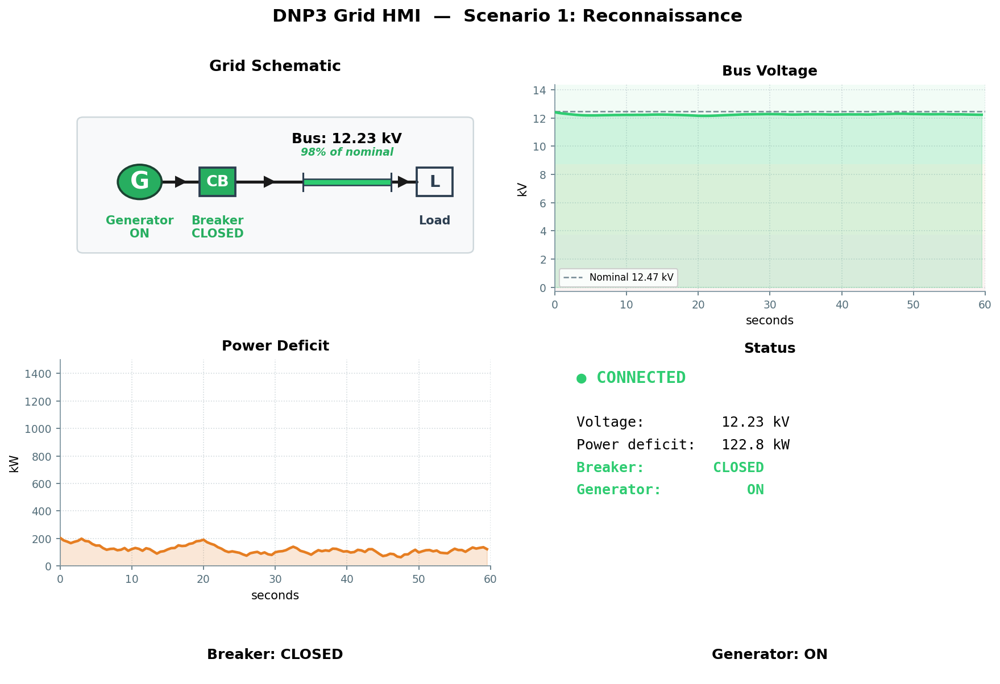
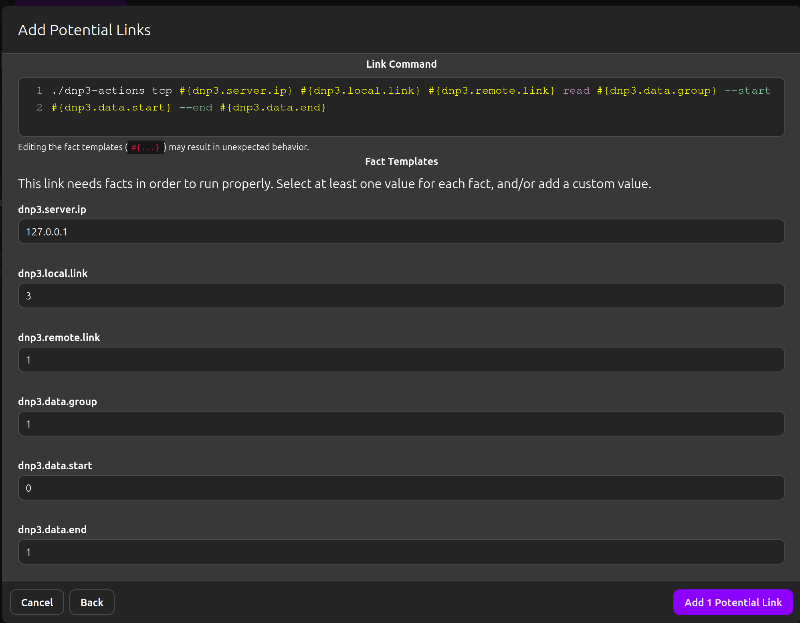

# Scenario 1: Reconnaissance

## Overview

| Field | Value |
|---|---|
| **Tactic** | Collection, Discovery |
| **Techniques** | [T0802 - Automated Collection](https://attack.mitre.org/techniques/T0802/), [T0861 - Point & Tag Identification](https://attack.mitre.org/techniques/T0861/) |
| **Target** | Grid Watch outstation over DNP3 |
| **Impact** | None - read-only operations only |

## Objective

Read all data points on the Grid Watch outstation without issuing any control
commands. This gives a baseline view of the breaker and generator controls,
their status inputs, the bus voltage, and the power deficit exposed by the
outstation.

## Fact Variables

| Fact | Description | Type | Default |
|------|-------------|------|---------|
| `dnp3.server.ip` | IP address of the outstation | string | `127.0.0.1` |
| `dnp3.local.link` | Link-layer address of the master | int | `3` |
| `dnp3.remote.link` | Link-layer address of the outstation | int | `1` |
| `dnp3.data.group` | DNP3 object group to read | int | `1` |
| `dnp3.data.start` | First index in the read range | int | `0` |
| `dnp3.data.end` | Last index in the read range | int | `1` |

## Caldera Operation

Load `docs/sources/grid-watch-simulator-facts.yml` as the fact source, then
build an operation using the following abilities in order:

| Step | Ability | Ability ID | Facts Used |
|------|---------|------------|------------|
| 1 | DNP3 (TCP) - Integrity Poll | `1d412b2f-f4ae-3ed2-822e-55a4490a7d1a` | `dnp3.server.ip`, `dnp3.local.link`, `dnp3.remote.link` |
| 2 | DNP3 (TCP) - Read All | `8d0889f8-6801-4986-baaf-83622bf08ced` | `dnp3.server.ip`, `dnp3.local.link`, `dnp3.remote.link`, `dnp3.data.group` |
| 3 | DNP3 (TCP) - Read | `689ee6dd-9f24-352f-90da-8d06fae7d19c` | `dnp3.server.ip`, `dnp3.local.link`, `dnp3.remote.link`, `dnp3.data.group`, `dnp3.data.start`, `dnp3.data.end` |

## Expected Observations

- The outstation accepts every request without authentication, and the reads do not change the grid.
- The integrity poll returns 2 binary inputs (`Group1Var2`), 2 binary outputs (`Group10Var2`) and 2 analog inputs (`Group30Var1`), plus any events since the last poll.
- `AI[0]` is the bus voltage in whole kV: 10 to 12 with the breaker closed and the generator on, otherwise 0 once it settles (about 10 seconds).
- `AI[1]` is the power deficit in kW: the load minus 600 (at least 0) with the breaker closed and the generator on, and the whole load (100 to 1500) otherwise.
- `BO[0]` and `BI[0]` are the breaker (1 = closed); `BO[1]` and `BI[1]` are the generator (1 = on). They start at 0.
- Read All and Read of group 1 return binary inputs 0 and 1 with the same values as the poll.

## See Also

- [Caldera for OT](https://github.com/mitre/caldera-ot)
- [ATT&CK for ICS - T0802](https://attack.mitre.org/techniques/T0802/)
- [ATT&CK for ICS - T0861](https://attack.mitre.org/techniques/T0861/)
