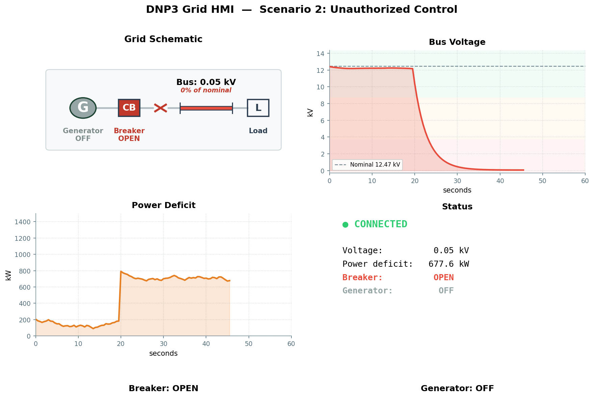

# Scenario 2: Unauthorized Control

## Overview

| Field | Value |
|---|---|
| **Tactic** | Impair Process Control, Impact |
| **Techniques** | [T1692.001 - Unauthorized Message: Command Message](https://attack.mitre.org/techniques/T1692/001/), [T0831 - Manipulation of Control](https://attack.mitre.org/techniques/T0831/), [T0826 - Loss of Availability](https://attack.mitre.org/techniques/T0826/) |
| **Adversary** | Grid Watch DNP3 Unauthorized Control (`docs/adversaries/dnp3-unauthorized-control.yml`) |
| **Fact source** | Grid Watch Unauthorized Control (`docs/sources/grid-watch-unauthorized-control.yml`) |

## Description

The adversary sends a single DIRECT_OPERATE command that latches off both outputs at once, opening the breaker and stopping the generator. The outstation runs it without authentication, the bus voltage collapses and the load goes unserved. Start with the breaker closed and the generator on (use the HMI buttons) so there is something to disrupt.

## Facts Used

| Fact | Description | Type | Value |
|---|---|---|---|
| `dnp3.server.ip` | IP address of the outstation | string | `127.0.0.1` |
| `dnp3.local.link` | Link address of the master | int | `3` |
| `dnp3.remote.link` | Link address of the outstation | int | `1` |
| `dnp3.data.group` | Object group to read | int | `1` (binary inputs) |
| `dnp3.operate.indices` | Binary outputs to operate | string | `0,1` (breaker and generator) |
| `dnp3.operate.mode` | Operate mode | string | `DIRECT_OPERATE` |
| `dnp3.operate.type` | Control relay output block type | string | `LATCH_OFF` |
| `dnp3.operate.tcc` | Trip-close code | string | `NUL` |

## Control Data

| Control | DNP3 Point | Value |
|---|---|---|
| BreakerControl | `BO[0]` | `LATCH_OFF` (open) |
| GenControl | `BO[1]` | `LATCH_OFF` (off) |

## Steps

Run the adversary with the fact source above. Each trait has a single value, so each ability runs once and the operation is three links in this order. The one Operate link names both outputs (`dnp3.operate.indices=0,1`), so a single command latches the breaker and the generator off together.

| # | Ability | ID | Facts |
|---|---|---|---|
| 1 | DNP3 (TCP) - Read All | `8d0889f8-6801-4986-baaf-83622bf08ced` | baseline: `dnp3.data.group=1` |
| 2 | DNP3 (TCP) - Operate | `5a073c32-e022-3724-85ad-7192464287b8` | trip breaker and stop generator: `dnp3.operate.indices=0,1`, `dnp3.operate.mode=DIRECT_OPERATE`, `dnp3.operate.type=LATCH_OFF`, `dnp3.operate.tcc=NUL` |
| 3 | DNP3 (TCP) - Integrity Poll | `1d412b2f-f4ae-3ed2-822e-55a4490a7d1a` | verify |

## Expected Observations

- The baseline Read All of group 1 shows `BI[0]` and `BI[1]` at 1 (breaker closed, generator on) if you set that state first with the HMI.
- The Operate step prints `Result Summary: SUCCESS`. The outstation accepts the command without authentication, and the PLC logs `CONTROL: BO[0] <- False (code=LATCH_OFF)` and `CONTROL: BO[1] <- False (code=LATCH_OFF)`.
- The final integrity poll shows `BO[0]`, `BO[1]`, `BI[0]` and `BI[1]` at 0.
- `AI[0]` falls from 10 to 12 kV to 0 kV within about 10 seconds. DNP3 reports analog values as whole numbers.
- `AI[1]` rises to the whole load, 100 to 1500 kW.
- The HMI shows the breaker open, the generator off and the voltage trace dropping to zero.
