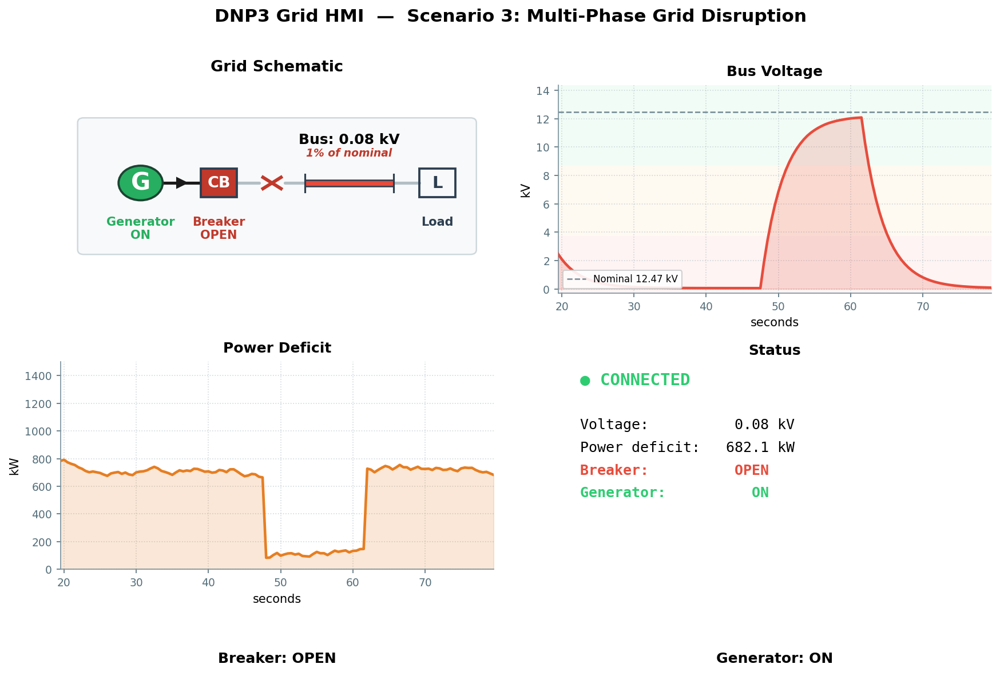

# Scenario 3: Grid Disruption

## Overview

| Field | Value |
|---|---|
| **Tactic** | Impair Process Control, Impact |
| **Techniques** | [T1692.001 - Unauthorized Message: Command Message](https://attack.mitre.org/techniques/T1692/001/), [T0831 - Manipulation of Control](https://attack.mitre.org/techniques/T0831/), [T0826 - Loss of Availability](https://attack.mitre.org/techniques/T0826/) |
| **Adversary** | Grid Watch DNP3 Grid Disruption (`docs/adversaries/dnp3-grid-disruption.yml`) |
| **Fact source** | Grid Watch Grid Disruption (`docs/sources/grid-watch-grid-disruption.yml`) |

## Description

The adversary uses the second DNP3 command path, SELECT_BEFORE_OPERATE. A single select-then-operate command latches off both outputs, opening the breaker and stopping the generator, and the grid blacks out. The outstation runs it without authentication, exactly as it runs the DIRECT_OPERATE command in Scenario 2. Start with the breaker closed and the generator on (use the HMI buttons).

## Facts Used

| Fact | Description | Type | Value |
|---|---|---|---|
| `dnp3.server.ip` | IP address of the outstation | string | `127.0.0.1` |
| `dnp3.local.link` | Link address of the master | int | `3` |
| `dnp3.remote.link` | Link address of the outstation | int | `1` |
| `dnp3.data.group` | Object group to read | int | `1` (binary inputs) |
| `dnp3.operate.indices` | Binary outputs to operate | string | `0,1` (breaker and generator) |
| `dnp3.operate.mode` | Operate mode | string | `SELECT_BEFORE_OPERATE` |
| `dnp3.operate.type` | Control relay output block type | string | `LATCH_OFF` |
| `dnp3.operate.tcc` | Trip-close code | string | `NUL` |

## Control Data

| Control | DNP3 Point | Value |
|---|---|---|
| BreakerControl | `BO[0]` | `LATCH_OFF` (open) |
| GenControl | `BO[1]` | `LATCH_OFF` (off) |

## Steps

Run the adversary with the fact source above. Each trait has a single value, so each ability runs once and the operation is three links in this order. The one Operate link names both outputs (`dnp3.operate.indices=0,1`) and uses SELECT_BEFORE_OPERATE, so the outstation first selects then operates both points in one exchange.

| # | Ability | ID | Facts |
|---|---|---|---|
| 1 | DNP3 (TCP) - Read All | `8d0889f8-6801-4986-baaf-83622bf08ced` | baseline: `dnp3.data.group=1` |
| 2 | DNP3 (TCP) - Operate | `5a073c32-e022-3724-85ad-7192464287b8` | trip breaker and stop generator: `dnp3.operate.indices=0,1`, `dnp3.operate.mode=SELECT_BEFORE_OPERATE`, `dnp3.operate.type=LATCH_OFF`, `dnp3.operate.tcc=NUL` |
| 3 | DNP3 (TCP) - Integrity Poll | `1d412b2f-f4ae-3ed2-822e-55a4490a7d1a` | verify |

## Restore and Re-disrupt (manual exercise)

The operation above leaves the grid blacked out. To rehearse restoring and re-disrupting it by hand, run the operation again and edit the Operate link's facts before it runs (the operation pauses on each link so you can review and change its command):

1. Restore the grid: set `dnp3.operate.type=LATCH_ON` on the Operate link. The one command latches both outputs on, closing the breaker and starting the generator. The voltage climbs back to 10 to 12 kV within about 10 seconds.
2. Disrupt it again: set `dnp3.operate.type=LATCH_OFF` (and, if you like, `dnp3.operate.indices=0` to trip only the breaker). The breaker opens and the voltage falls to 0 kV.

These edits change a single link's facts and need no change to the fact source.

## Expected Observations

- The baseline Read All of group 1 shows `BI[0]` and `BI[1]` at 1 (breaker closed, generator on) if you set that state first with the HMI.
- The Operate step prints `Result Summary: SUCCESS` over SELECT_BEFORE_OPERATE. The outstation asks for no authentication, and the PLC logs `CONTROL: BO[0] <- False (code=LATCH_OFF)` and `CONTROL: BO[1] <- False (code=LATCH_OFF)`.
- The HMI shows the generator off and the breaker open, the voltage trace falls to 0 kV and the deficit rises to the whole load.
- The final integrity poll shows `BO[0]`, `BO[1]`, `BI[0]` and `BI[1]` at 0, `AI[0]` falling to 0 kV and `AI[1]` at the whole load, 100 to 1500 kW. DNP3 reports analog values as whole numbers.
