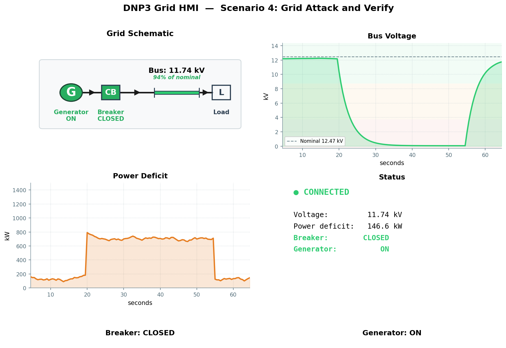

# Scenario 4: Grid Attack and Verify

## Overview

| Field | Value |
|---|---|
| **Tactic** | Impair Process Control, Impact, Collection, Inhibit Response Function |
| **Techniques** | [T1692.001 - Unauthorized Message: Command Message](https://attack.mitre.org/techniques/T1692/001/), [T0831 - Manipulation of Control](https://attack.mitre.org/techniques/T0831/), [T0826 - Loss of Availability](https://attack.mitre.org/techniques/T0826/), [T0802 - Automated Collection](https://attack.mitre.org/techniques/T0802/), [T0861 - Point & Tag Identification](https://attack.mitre.org/techniques/T0861/), [T0816 - Device Restart/Shutdown](https://attack.mitre.org/techniques/T0816/) |
| **Adversary** | Grid Watch DNP3 Grid Attack and Verify (`docs/adversaries/dnp3-grid-attack-and-verify.yml`) |
| **Fact source** | Grid Watch Grid Attack and Verify (`docs/sources/grid-watch-grid-attack-and-verify.yml`) |

## Description

The adversary trips the breaker, reads the outstation back to confirm the change, then tries a warm restart. The operate command and every read run without authentication. The outstation does not support restarts, so the last step fails. Start with the breaker closed (use the HMI button).

## Facts Used

| Fact | Description | Type | Value |
|---|---|---|---|
| `dnp3.server.ip` | IP address of the outstation | string | `127.0.0.1` |
| `dnp3.local.link` | Link address of the master | int | `3` |
| `dnp3.remote.link` | Link address of the outstation | int | `1` |
| `dnp3.operate.indices` | Binary output to operate | string | `0` (breaker) |
| `dnp3.operate.mode` | Operate mode | string | `DIRECT_OPERATE` |
| `dnp3.operate.type` | Control relay output block type | string | `LATCH_OFF` |
| `dnp3.operate.tcc` | Trip-close code | string | `NUL` |
| `dnp3.data.group` | Object group to read | int | `1` (binary inputs) |
| `dnp3.data.start` | First index to read | int | `0` |
| `dnp3.data.end` | Last index to read | int | `1` |

## Control Data

| Control | DNP3 Point | Value |
|---|---|---|
| BreakerControl | `BO[0]` | `LATCH_OFF` (open) |

## Steps

Run the adversary with the fact source above. Each trait has a single value, so each ability runs once and the operation is five links in this order:

| # | Ability | ID | Facts |
|---|---|---|---|
| 1 | DNP3 (TCP) - Operate | `5a073c32-e022-3724-85ad-7192464287b8` | trip breaker: `dnp3.operate.indices=0`, `dnp3.operate.mode=DIRECT_OPERATE`, `dnp3.operate.type=LATCH_OFF`, `dnp3.operate.tcc=NUL` |
| 2 | DNP3 (TCP) - Read | `689ee6dd-9f24-352f-90da-8d06fae7d19c` | verify: `dnp3.data.group=1`, `dnp3.data.start=0`, `dnp3.data.end=1` |
| 3 | DNP3 (TCP) - Read All | `8d0889f8-6801-4986-baaf-83622bf08ced` | verify: `dnp3.data.group=1` |
| 4 | DNP3 (TCP) - Integrity Poll | `1d412b2f-f4ae-3ed2-822e-55a4490a7d1a` | verify |
| 5 | DNP3 (TCP) - Warm Restart | `fe8403ab-e37c-40b6-8f0e-6b0b4192f675` | restart |

## Expected Observations

- The Operate step prints `Result Summary: SUCCESS`: the outstation accepts the command without authentication and sets `BO[0]` (breaker) to 0.
- The Read and Read All steps show binary input 0 (breaker status) at 0.
- The integrity poll shows `BO[0]` at 0, `AI[0]` (bus voltage) falling to 0 kV within about 10 seconds and `AI[1]` (power deficit) at the whole load, 100 to 1500 kW. DNP3 reports analog values as whole numbers.
- The Warm Restart step prints `Restart failed: FAILURE_BAD_RESPONSE`: the outstation answers "function code not supported", and the grid state does not change.
